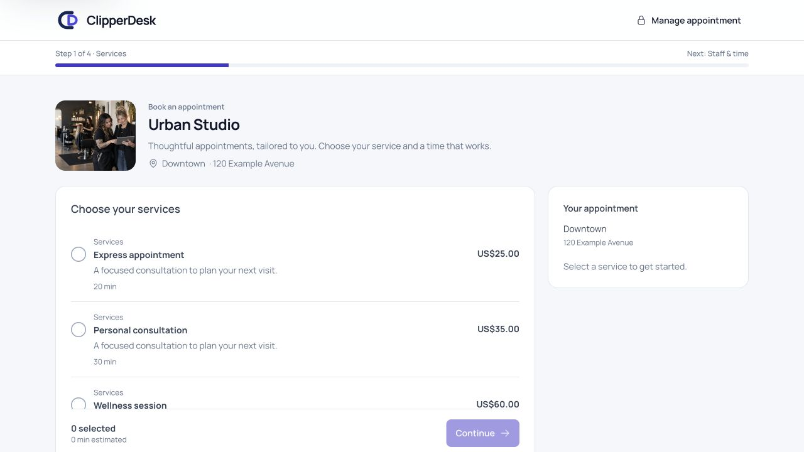
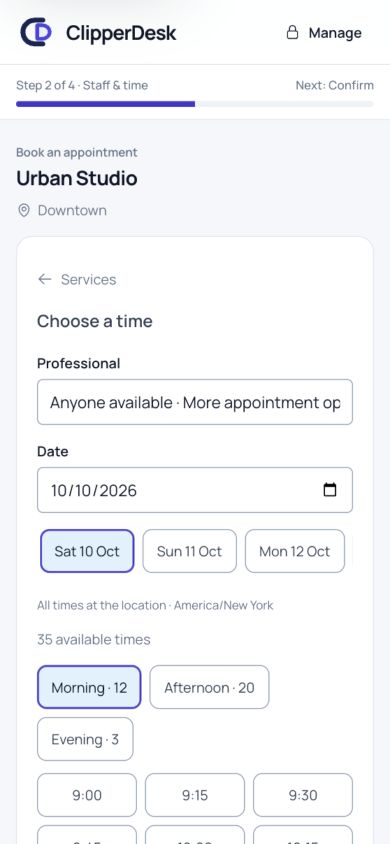
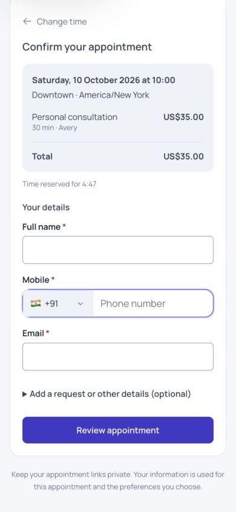
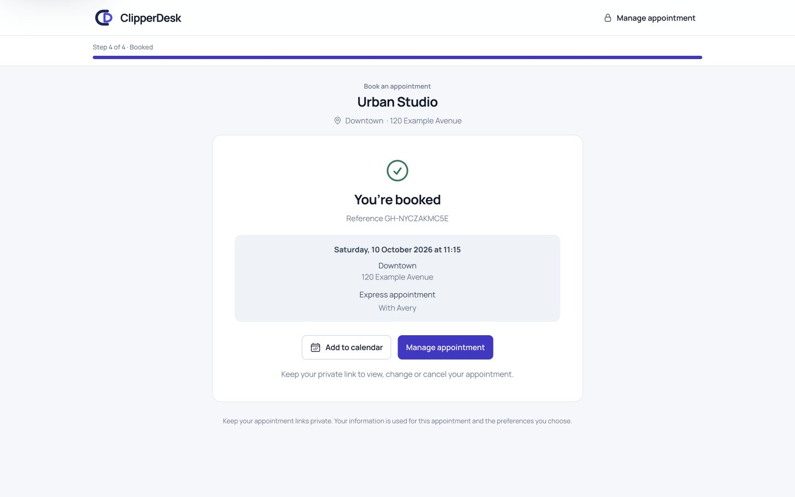
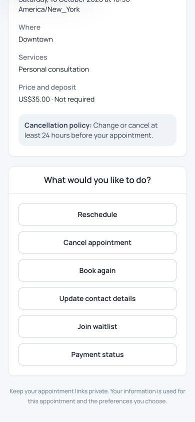

# Public booking experience audit and implementation

Date: 2026-10-10. Requirements: FR-01/03/06/07/09/10/19/20; ADR-055.
Scope: public catalog, booking, secure appointment management, waitlist,
business setup links/slugs, shared scheduling and production routing contract.

## Outcome

The no-deposit guest journey is implemented and verified locally on both origins.
Customers choose services, staff/time and essential details, review in place,
then see a centered confirmation with calendar and private management actions.
This is repository/local verification, not a production launch certification.
Paid public checkout remains incomplete under OPEN-16; provider, regional,
privacy and release gates in the existing project status still apply.

## Findings and changes

| Finding | Implemented improvement |
| --- | --- |
| Mobile continuation depended on a desktop-only summary | Dedicated mobile continuation and responsive summary; comfortable controls and explicit progress/back actions |
| Previous-visit question added friction and was self-declared | Removed it; privately classify an unambiguous active same-business name/contact match during review, rejecting contradictory contacts |
| Country names were clipped inside a wide phone selector | Compact flag/dial code, accessible full label, wider searchable country menu, international pasted-number inference |
| Dense time lists and manual rescheduling input | Location-local bounded date rail, morning/afternoon/evening groups, actual available secure reschedule choices |
| Generic loading and visually uneven success/management sections | Reusable accessible skeletons for flow restoration, availability and page navigation; centered confirmation and management headings/actions |
| Changing a held time could consume capacity unnecessarily | Explicit release and atomic replacement, with rollback restoring the former hold when a new hold fails |
| Refresh/uncertain confirmation could lose progress or repeat submission | Secret-validated resume, stable frozen confirmation request/key, server flow serialization and confirmed replay |
| Public projections included internal scheduling plan details | Whitelisted public slot fields; no plan, resources, private configuration, saved profile/history or client classification returned |
| Review could diverge from confirmation eligibility/deposit | Bound essential details with an HMAC; re-evaluate client rules, current configuration, actual deposit and authoritative capacity before commit |
| Incompatible new-client/returning-client selections caused confusing availability | Restriction badges, incompatible-selection prevention, required-staff compatibility checks and clear server validation |
| Cancellation policy could change retroactively | Secure action cutoff uses the accepted policy snapshot, with legacy fallback |
| Waitlist matching searched only the first 20 openings | Exact opening lookup through the shared authoritative engine; late-day openings remain eligible |
| Public waitlist submitted through Axios received a redirect | Validated JSON response with existing duplicate-request convergence |
| Random setup links and separate current/alias uniqueness checks | Readable onboarding slugs and one database-reserved namespace, including historical aliases/deletion tombstones |
| Public links and canonical metadata promoted the fallback | Centralized environment-aware primary URLs in setup/copy/services/publication/rebook/payment return and canonical metadata |
| Booking subdomain architecture was incomplete | Domain route and main-domain fallback share the controller, Vue component and domain services; local host ports supported |
| Historical flow state could retain raw access secrets | New state whitelist plus migration scrub; existing digest remains usable |
| Guest error page assumed authenticated Jetstream flash props | Optional guest-safe access; unavailable routes render without that JavaScript exception |

Contact matching is a classification aid, not authentication, authorization,
proof of a completed visit, or permission to expose an existing profile. Required
fields remain name, mobile and email; optional preferences are progressively
disclosed. No contacts are persisted in browser session storage or flow state.
Existing customer-owned action tokens and tenant rules remain authoritative.

## Design references and fit

The review used primary product documentation. The resulting flow favors a clear
catalog, availability-led selection, optional staffing when permitted, essentials
only, visible appointment details and useful confirmation actions. ClipperDesk's
multi-service, segmented scheduling and policy engine remain its own architecture.

- [Fresha customer online booking](https://www.fresha.com/help-center/knowledge-base/online-presence/102398-learn-how-clients-book-appointments-online)
  and [new appointment assignment](https://www.fresha.com/help-center/knowledge-base/calendar/102178-set-up-new-appointment-assignment): service/team/time selection and assignment without forcing unnecessary preference.
- [Booksy getting started](https://booksy.com/biz/en-us/lp/getting-started-on-booksy)
  and [business features](https://biz.booksy.com/features): readable business/service presentation and direct booking links.
- [Square Appointments documentation](https://squareup.com/help/us/en/topic/appointments): configuration-driven online booking, customer details and appointment management.
- Calendly's official time-zone help was reviewed for explicit local-time presentation;
  ClipperDesk uses the appointment location's governing time zone and distinguishes
  repeated daylight-saving wall times. A customer time-zone conversion selector
  was not introduced for this location-based journey.

This is a documented pattern review, not measured conversion research or a
claim that these platforms have identical flows.

## Validation

| Check | Verified result |
| --- | --- |
| Full backend regression | 583 passed, 5,626 assertions; 30 skipped; 3 pre-existing billing failures |
| Focused booking-domain regressions | 247 passed, 2,360 assertions before the final cutoff addition; final public booking suite 27 passed, 213 assertions; all are also covered by the final full run |
| Real MySQL parallel-process races | 14 passed, 55 assertions in a separately created disposable database; includes competing public confirmations and cross-business slug claims |
| Frontend helper suite | 75 passed, including date arithmetic, service eligibility, storage failure and country-menu width |
| Client and SSR production builds | Passed using Node 24; installed dependency lock files unchanged |
| Route/config cache generation | Passed with isolated cache output; development hostname with port matches correctly |
| PHP formatting and whitespace | Pint dirty check and git diff check passed |
| Browser guest bookings | Completed on `book.localhost:8016/urban-studio` and `127.0.0.1:8016/book/urban-studio`, without sign-in or CSRF/CORS exceptions |
| Recovery and phone controls | Held refresh restores public selections; confirmed refresh does not duplicate; changing time releases former capacity and retains in-memory contacts; India country search and international paste verified |
| Secure rescheduling | Selected and committed a synthetic appointment from 10:00 to 10:30; new view reports rescheduled with its replacement reference |
| Responsive inspection | Booking screens checked at mobile widths; centered confirmation measured at 320/390/768/1440 px without horizontal overflow; 390 px management headings all centered |

The full run's billing failures reproduce on unchanged HEAD in an isolated
baseline: `BillingWorkspaceTest.php:64` (402 rather than 200), line 77 (missing
historical subscription price), and `CapacityBillingTest.php:338` (usage-history
sum 0 rather than 15). They were not caused by booking edits and remain unresolved.
The SQLite full run skips 14 opt-in MySQL checks and 16 intentionally superseded
Jetstream checks; MySQL checks were separately executed successfully.

Local MySQL measurement: search 218.35 ms / 726 queries; commit 24.96 ms /
61 queries. These are one synthetic run, not production percentiles. Exact
waitlist lookup, past-time skipping, aborted stale requests and cached frontend
time formatters reduce avoidable work. General availability still performs many
authoritative reads and needs target-topology profiling/load testing; no stale
availability cache was introduced.

Browser fixtures contain synthetic contacts and use fake communications. No
external email/text/payment was sent. The real application database was not
migrated or changed by these checks; only isolated test databases were used.
Temporary credentials, fixtures, caches and raw execution logs are ignored under
`tmp/public-booking-audit/`, not release artifacts.

## Visual evidence

## Remaining release work

1. Follow the [deployment runbook](../../deployment/public-booking.md): database
   backup/migration, environment/config/route caches, DNS, Forge additional
   domain, SSL/renewal and external checks of both URL formats. None of the live
   infrastructure was modified or verified here.
2. Complete and certify the existing paid booking payment/return/status journey
   before enabling paid self-service. Required deposits cannot confirm unpaid;
   the current interface accurately offers contact with the business.
3. Address the three baseline billing failures, target-database availability
   query/load testing, independent WCAG assessment and Safari/Firefox/Edge
   coverage. Local Chromium inspection does not certify WCAG 2.2 AA.
4. Complete the existing provider delivery, regional/privacy/consent and
   operational release gates. Confirmation does not assert message delivery.
