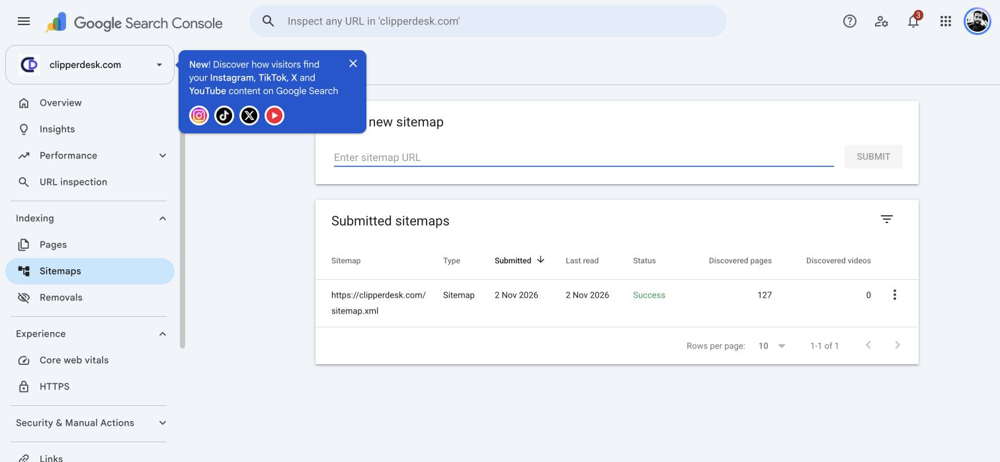

# Search Console and public crawl audit — 2026-11-02

Scope: owner-authorized technical SEO, Google Search Console discovery/index
checks, and existing public pages. Requirements: PRD sections 1–4/12/15,
ADR-024/026/065. Private links, account pages and unapproved legal documents
retain their existing exclusions. No content, legal or general release gate is
waived. Concurrent Google Analytics changes in this shared checkout belong to
the separate Analytics audit.

## Confirmed Google results

- Domain property `sc-domain:clipperdesk.com` was already accessible through
  the owner's signed-in browser. No new credentials, delegation or verification
  records were created.
- There were no submitted sitemaps. Submitted
  `https://clipperdesk.com/sitemap.xml`; Google acknowledged submission, first
  displayed Couldn't fetch, then reported **Success / 127 discovered pages**.
  No XML change or repeated submission was needed. See the screenshot below.
- Direct URL Inspection of every marketing page found **16 indexed, 15 unknown
  to Google with no recorded crawl, and 1 excluded duplicate**. The duplicate
  `/use-cases` declares the apex canonical, but Google selected
  `https://www.clipperdesk.com/use-cases` on its saved crawl. Current www URLs
  redirect to the apex; request a fresh crawl when browser access resumes.
- Help inspection reached **57/95 URLs: 56 indexed and one discovered but not
  indexed** (`/help/articles/account-profile`). Google then explicitly stopped
  inspection with its daily property quota message; the remaining **38 Help
  URLs are uninspected**, never inferred indexed from HTTP responses.
  Combined direct evidence is **89 checked / 72 indexed / 17 not indexed**,
  plus 38 not checked. The initial marketing snapshot preceded sitemap
  processing: subsequent checks show blog and barbershops discovered with the
  accepted sitemap; company still reports unknown. Preserve these timestamps
  and distinctions rather than rewriting the original observations.
- The Pages aggregate report is dated **2026-10-23**: 8 indexed and 12 excluded
  (8 redirects, 2 alternate canonicals, 1 noindex and 1 Google-selected duplicate).
  These stale totals are not interchangeable with the direct inspections.
  Intentional exclusions must not be marked as errors solely to reach 100%.
- Pricing's Google live test said **URL is available to Google / Page can be
  indexed**. Its saved index result also says indexed. A successful live test
  is not itself an indexing or ranking confirmation.
- Manual actions and Security issues: **No issues detected**. Crawl stats last
  updated 31 October: 1.97k requests in the last 90 days, all three hosts show
  No problems. The apex robots/DNS/server-connectivity fail rates are acceptable;
  that aggregate health assessment does not establish a valid robots response.
  Settings explicitly reports **No robots.txt file**. HTTPS last updated
  1 November: 0 non-HTTPS, 7 HTTPS sample URLs, no critical issues. Core Web
  Vitals last updated 31 October: insufficient mobile and desktop usage data;
  no field-performance pass or fail can be claimed. See `google-health.json`.
- Performance, three-month range selected: **0 clicks, 28 impressions, 0% CTR,
  average position 61.8**; chart displayed 11–31 October 2026 and last update
  3 hours ago. Saved page tables include 15 rows. Page aggregates can differ
  from property totals. These small samples do not establish durable keyword
  rankings or promise customer acquisition.

## Live website and hosting

The [initial crawl](live-crawl-summary.md) covered every one of the 127 sitemap
URLs, plus public utilities, private/auth exclusions and retired routes.
All sitemap pages returned 200 with correct self canonicals, unique metadata
and valid JSON-LD. However, 32 marketing pages had empty initial HTML bodies;
95 Help URLs had readable fallback HTML.

Enabled Forge's official **Inertia SSR** feature with its automatic deployment
restart option selected. Forge then showed a Running supervised process:
`php8.5 artisan inertia:start-ssr`, working directory
`/home/forge/clipperdesk.com/current`. The first post-change homepage GET had
one H1, one main region and 38 links. The complete post-change HTTP check
verified **127/127 pages**, with zero page failures, including rendered content.
See [post-SSR readiness report](live-readiness-after-ssr.json).

The overall readiness result remains **false** because `/robots.txt` returns
**404**, even though its body is correct. Read-only Forge inspection confirmed
the exact robots location lacks `try_files`, and `error_page 404 /index.php`
preserves the missing-static-file status. The exact small routing repair and
rollback are prepared in [search operations](../../deployment/search-indexing.md).
No Nginx configuration was saved by this task.

The owner confirmed a concurrent deployment and requested Google checks first.
Further hosting changes are on hold. The managed SSR service had already been
started before that reply arrived. No source deployment was triggered here.
Browser automation was briefly disabled, then restored by the owner. Manual
Request indexing for barbershops failed: Google reported a submission problem
and inability to connect to reCAPTCHA. A reload and one retry produced the same
explicit failure; stopped further manual submissions. **Zero manual requests
are confirmed accepted**, and no CAPTCHA was solved or bypassed. The accepted
sitemap remains active. Later the property inspection quota was reached and
all further inspections stopped; Google's message says the quota renews daily.
No ongoing monitoring or recurring automation has been created.

Actual Chrome smoke checks at desktop and **390 CSS px** passed for home,
barbershops, pricing and Help: correct single heading/canonical/description/
robots, no overflow or broken images, working real links/back navigation and
mobile navigation. Screenshots were visually checked; viewport overrides were
reset. These are targeted checks, not a complete mobile audit of 127 pages or
a field Core Web Vitals certification. See `browser/results.json` and screenshots.

## Local implementation and validation

- `PublicSitemap` shares the existing curated URL projection between the live
  endpoint and legacy command. `generate:sitemap` prints exact XML and performs
  no outbound crawl or write to `public/sitemap.xml`. Existing static files are
  left for explicit operator inspection. Publication withdrawal remains dynamic.
- `scripts/check-public-seo.mjs` is a bounded read-only original-HTML checker,
  with three concurrent GETs, request/response limits, exact-origin public-route
  validation and no redirects. It writes only when given an explicit output
  path. See the runbook for execution and limitations.
- Marketing and HelpCenter regressions: **183 passed / 3,778 assertions**.
  New checker tests: **4 passed**, including wrong-status robots and empty SSR.
  Focused command rerun: **3 passed / 21 assertions**. Scoped Pint passed.
  The command/service/checker changes are local, uncommitted and not deployed.
  No frontend source is changed by this SEO task; no new client build is claimed.

## Remaining work, in order

1. After Google's daily property inspection quota renews, inspect the remaining
   **38 Help URLs** listed explicitly in `google-help-inspections.json`. Retry
   eligible missing-page/apex duplicate manual submissions only after Google's
   reCAPTCHA service is available, or let the already accepted sitemap drive
   discovery. Do not bypass challenges/quotas or count a failed request as saved.
2. After the owner's concurrent deployment completes, inspect its final state,
   apply the prepared robots fallback through Forge, verify HTTP 200, and rerun
   the full readiness checker. Preserve this baseline and inspect SSR restart
   behavior after a real deployment. No successful green overall gate yet exists.
3. Recheck Google-rendered content and the actual desktop/mobile smoke set after
   the stable deployment. Preserve intended noindex/redirect exclusions and
   wait for enough field data before assessing Core Web Vitals.
4. Review Google's refreshed sitemap/Page indexing/URL Inspection results and
   record changes separately from HTTP fetchability. Then compare performance
   by page/query over time; substantive content/authority work should follow
   observed customer search intent, without unsupported feature claims.

Google explicitly distinguishes discovery from indexing and provides no guarantee
that every submitted URL is indexed or ranks:
[Google sitemap guidance](https://developers.google.com/search/docs/crawling-indexing/sitemaps/build-sitemap),
[Google URL recrawl guidance](https://developers.google.com/search/docs/crawling-indexing/ask-google-to-recrawl).

## Evidence files

| File | Meaning |
| --- | --- |
| `live-crawl.json` / `.csv` | Full original-HTML baseline, all 127 URLs plus utilities |
| `live-readiness-after-ssr.json` | All 127 pages pass; robots status still fails |
| `live-after-ssr-home.json` | First verified rendered homepage after enabling SSR |
| `live-googlebot-check.json` | User-agent check; not proof of verified Google-source access |
| `live-sitemap-integrity.json` | Valid identical XML with ordinary/Googlebot/gzip checks |
| `google-sitemap-success.png` | Google reports Success / 127 discovered URLs |
| `google-url-inspections.json` / `.csv` | Each of the 32 marketing URL inspection results |
| `google-help-inspections.json` / `.csv` | All 95 Help URLs, with 38 explicitly uninspected after quota |
| `page-indexing-register.json` / `.csv` | Combined 127-page HTTP and latest recorded Google status inventory |
| `google-marketing-after-submission.json` | Additional discovery observations after sitemap acceptance |
| `google-index-requests.json` / `google-index-request-error.png` | Google's manual submission/reCAPTCHA service failure |
| `google-inspection-quota.png` | Explicit daily property inspection limit |
| `google-health.json` | Google crawl, HTTPS, robots and field-experience reports |
| `browser/results.json` and PNGs | Desktop and 390px live browser smoke evidence |
| `google-performance.json` | Visible Google property totals and page performance tables |
